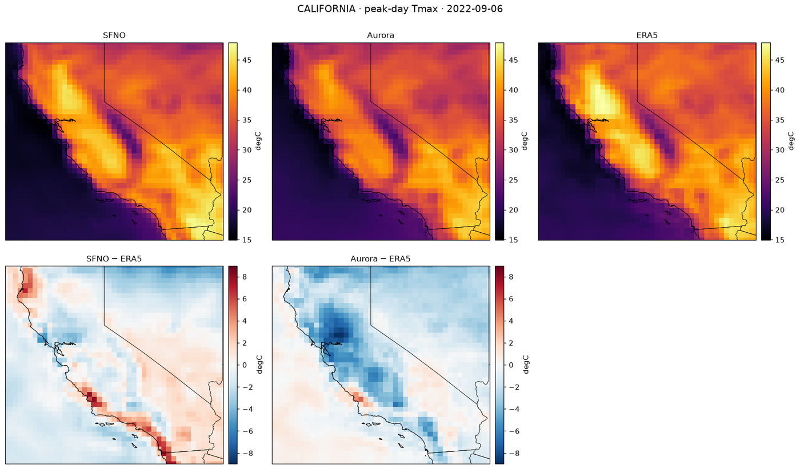
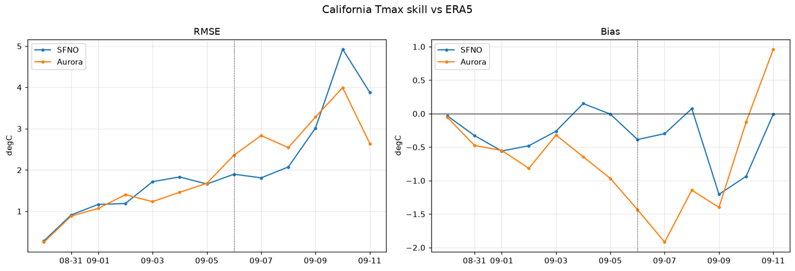
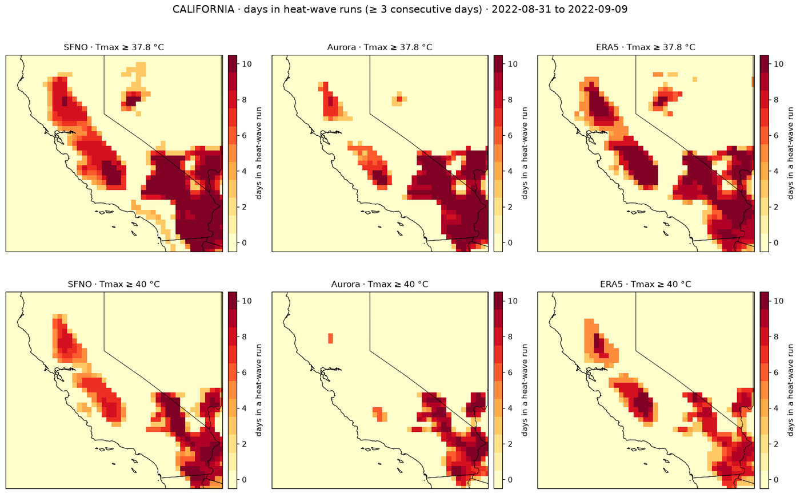
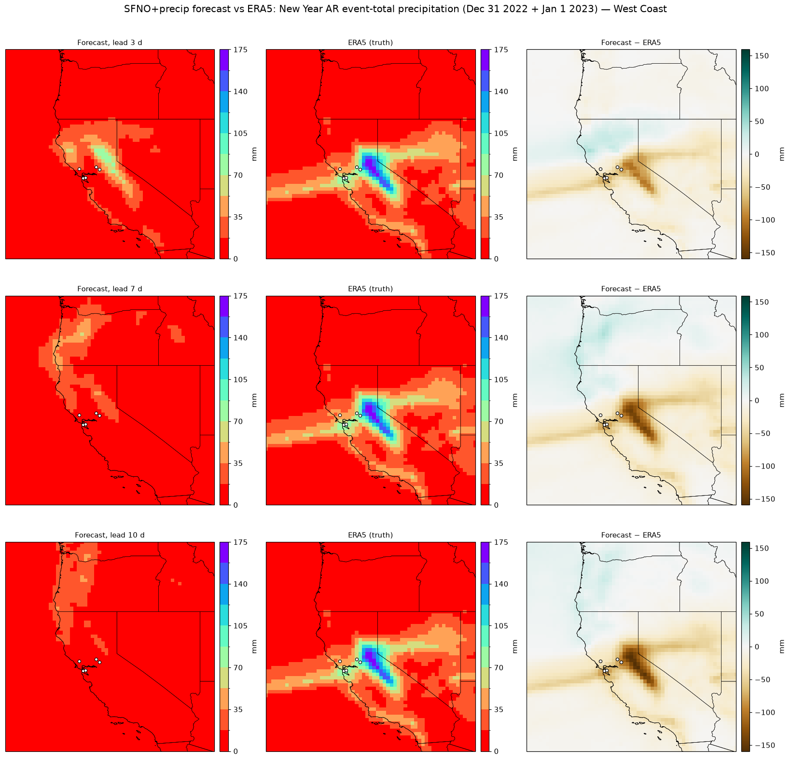

# West Coast Weather Forecasts — AI Models vs ERA5



Two notebooks compare AI weather models with ERA5 on West Coast extremes, using [NVIDIA Earth2Studio](https://github.com/NVIDIA/earth2studio): `HeatWaves.ipynb` runs NVIDIA's SFNO and Microsoft's Aurora on the September 2022 California heat wave (peak around 6 September), and `Flooding.ipynb` runs NVIDIA's SFNO together with the PrecipitationAFNO v2 precipitation model, initialized 3, 7 and 10 days before the New Year 2022–23 atmospheric river. SFNO has no precipitation output of its own, so the flood notebook's precipitation is a model-derived estimate from that second network.

## Results at a glance

Bias is always model − ERA5. The heat-wave table scores daily maximum 2 m temperature in °C at global, CONUS and California scales, on the peak day and averaged over the event window (31 August – 9 September 2022). The flood table scores event-total precipitation (Dec 31 – Jan 1) over the West Coast box in mm for each lead time. ERA5 is the reference for both, but ERA5 precipitation is itself model-derived (reanalysis output, not gauge or radar data), so these numbers measure agreement with ERA5, not with observed rainfall.

**Heat wave: daily maximum 2 m temperature against ERA5, by region and model**

<!-- HeatWaves_metrics:START -->
| Region | Model | Peak-day bias (°C) | Peak-day RMSE (°C) | Peak-day MAE (°C) | Event-mean bias (°C) | Event-mean RMSE (°C) |
|---|---|---|---|---|---|---|
| Global | SFNO | -0.30 | 2.64 | 1.61 | -0.22 | 2.17 |
| Global | Aurora | -0.70 | 2.40 | 1.63 | -0.58 | 1.90 |
| Conus | SFNO | -0.17 | 2.45 | 1.76 | 0.42 | 2.08 |
| Conus | Aurora | -0.68 | 2.78 | 2.14 | -0.45 | 2.31 |
| California | SFNO | -0.39 | 1.90 | 1.48 | -0.33 | 1.73 |
| California | Aurora | -1.43 | 2.36 | 1.71 | -0.97 | 1.87 |
<!-- HeatWaves_metrics:END -->

**Flood: SFNO + PrecipitationAFNO v2 event-total precipitation against ERA5, by lead time**

<!-- Flooding_metrics:START -->
_Filled in after the verified run._
<!-- Flooding_metrics:END -->



*Heat wave: how the error of each model against ERA5 grows with forecast day over California; the dotted line marks the peak.*



*Heat wave: days that belong to a run of three or more consecutive days above each threshold, model against ERA5.*



*Flood: event-total precipitation (Dec 31 – Jan 1) from SFNO + PrecipitationAFNO v2 at each lead time next to ERA5, with SFNO + PrecipitationAFNO v2 − ERA5 in the last column.*


*Flood: event totals at the exact grid cell of five flood-affected locations, ERA5 against SFNO + PrecipitationAFNO v2 at each lead time.*

## Models and data

| Model | Developer | Notebook | Initial condition |
|---|---|---|---|
| SFNO | NVIDIA | `HeatWaves.ipynb` | ERA5 (Copernicus CDS), 2022-08-30 00Z, 12-day forecast |
| Aurora | Microsoft | `HeatWaves.ipynb` | ERA5 (Copernicus CDS), 2022-08-30 00Z, 12-day forecast |
| SFNO + PrecipitationAFNO v2 | NVIDIA | `Flooding.ipynb` | ERA5 (Copernicus CDS) at 2022-12-21, 2022-12-24 and 2022-12-28 00Z |
| ERA5 | ECMWF reanalysis | both | reference: daily maximum 2 m temperature (from 6-hourly samples) and total precipitation (hourly accumulations) |

## Quick start

Requires Python 3.12, [uv](https://docs.astral.sh/uv/), and an NVIDIA GPU with about 48 GB of VRAM (developed and tested on an L40).

```bash
git clone https://github.com/ChristianByars/West-Coast-Forecasts.git
cd West-Coast-Forecasts
uv sync
uv run python -m ipykernel install --user --name west-coast --display-name "west-coast"
```

`uv sync` expects a prebuilt torch-harmonics wheel in a `wheels/` folder; see [docs/environment.md](docs/environment.md).

Open a notebook in JupyterLab and select the **west-coast** kernel, then run all cells.

## Notebooks

<!-- RUNS:START -->
_Runtime and GPU memory are filled in after the verified run._
<!-- RUNS:END -->

| Notebook | Event | Models | Verified against |
|---|---|---|---|
| `HeatWaves.ipynb` | September 2022 California heat wave | SFNO, Aurora | ERA5 daily maximum 2 m temperature at global, CONUS and California scales |
| `Flooding.ipynb` | New Year 2022–23 atmospheric-river flood | SFNO + PrecipitationAFNO v2 at 3, 7 and 10 days of lead | ERA5 daily and event-total precipitation over the West Coast |

## Repository layout

```text
HeatWaves.ipynb       SFNO vs Aurora: September 2022 California heat wave
Flooding.ipynb        SFNO + PrecipitationAFNO v2 lead-time sweep: New Year 2022-23 atmospheric river
metrics.py            area-weighted skill metrics
tests/                unit tests for metrics.py
docs/images/          figures shown in this README
docs/results/         CSV metric tables written by the notebooks
docs/environment.md   pinned versions and install notes
data/                 generated forecasts and ERA5 downloads (gitignored)
figures/              generated figures (gitignored)
```

## Environment notes

Pinned versions, install caveats, and fixes are in [docs/environment.md](docs/environment.md).

## References

- [NVIDIA Earth2Studio](https://github.com/NVIDIA/earth2studio) and its [documentation](https://nvidia.github.io/earth2studio/)
- [ERA5 hourly data on single levels](https://cds.climate.copernicus.eu/datasets/reanalysis-era5-single-levels) (Copernicus Climate Data Store)
- [Spherical Fourier Neural Operators: Learning Stable Dynamics on the Sphere](https://arxiv.org/abs/2306.03838) (the SFNO paper) and [Modulus-Makani](https://github.com/NVIDIA/modulus-makani), the NVIDIA code SFNO is trained with
- [SFNO 73-channel checkpoint](https://catalog.ngc.nvidia.com/orgs/nvidia/teams/modulus/models/sfno_73ch_small) and [PrecipitationAFNO v2 checkpoint](https://catalog.ngc.nvidia.com/orgs/nvidia/teams/earth-2/models/afno_dx_tp-v1-era5) (NVIDIA NGC)
- [uv](https://docs.astral.sh/uv/)
